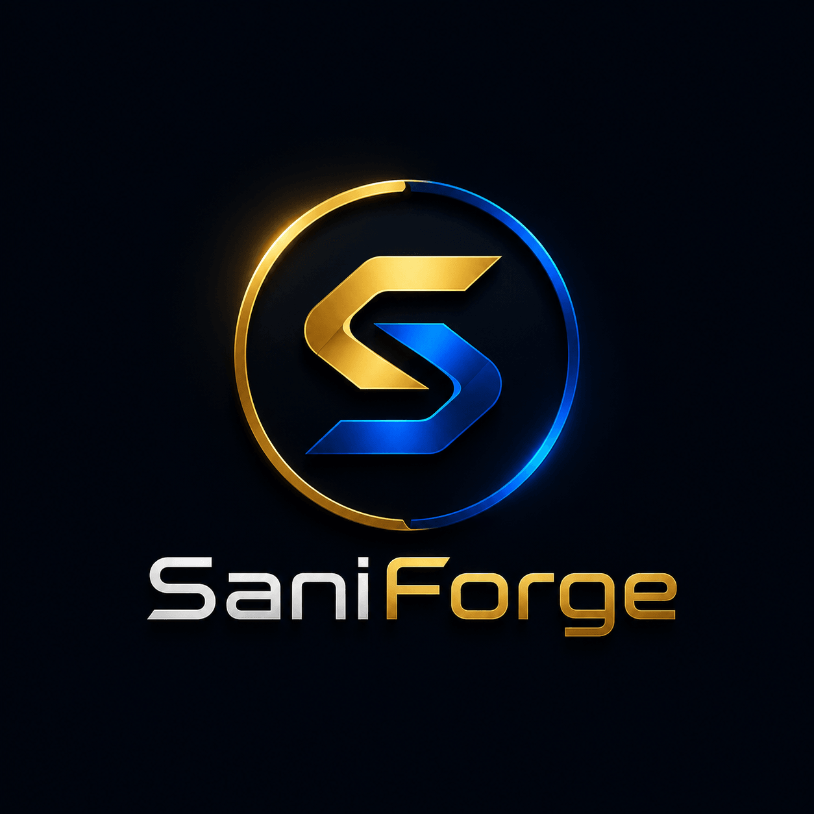

  

<h1 align="center">SaniForge</h1>

  Websites, words &amp; automated systems for businesses that want to scale faster. 
  <a href="https://www.saniforge.space">www.saniforge.space</a>

  

## About

Source code for [SaniForge](https://www.saniforge.space), the portfolio and studio site of **Abdul Kaiyum Sani**: n8n developer, full-stack developer and growth engineer, and a core team member at [GrowMinion](https://growminion.com/). Built with Next.js (App Router), TypeScript and Tailwind CSS, with MDX-powered blog and case study content.

## Features

- Home, About, Services, Projects, Blog and case-study pages
- MDX blog and work content with reading time, related posts and table of contents
- Contact form (Supabase), booking, WhatsApp and social links
- SEO metadata, sitemap, JSON-LD structured data, Google Tag Manager and GA4 events

## Tech Stack

Next.js · TypeScript · Tailwind CSS · MDX · Supabase · Framer Motion · Lucide Icons

## Links

- Live site: [saniforge.space](https://www.saniforge.space)
- About SaniForge: [saniforge.space/about](https://www.saniforge.space/about)
- Blog: [saniforge.space/blog](https://www.saniforge.space/blog)
- GrowMinion: [growminion.com](https://growminion.com/)
- LinkedIn: [linkedin.com/in/sani48](https://www.linkedin.com/in/sani48)
- Facebook: [facebook.com/abdulkaiyum.sani.50](https://www.facebook.com/abdulkaiyum.sani.50)
